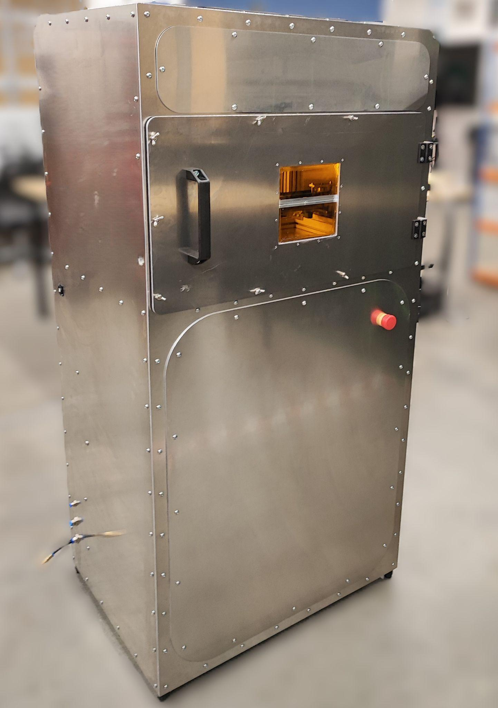
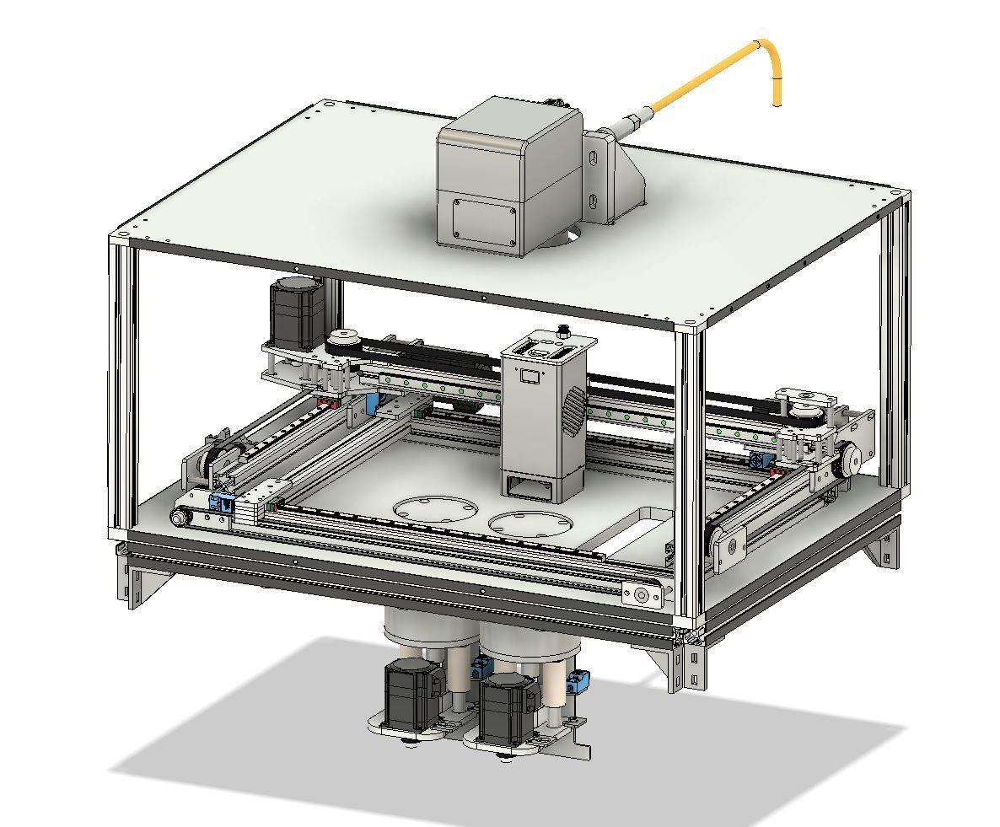
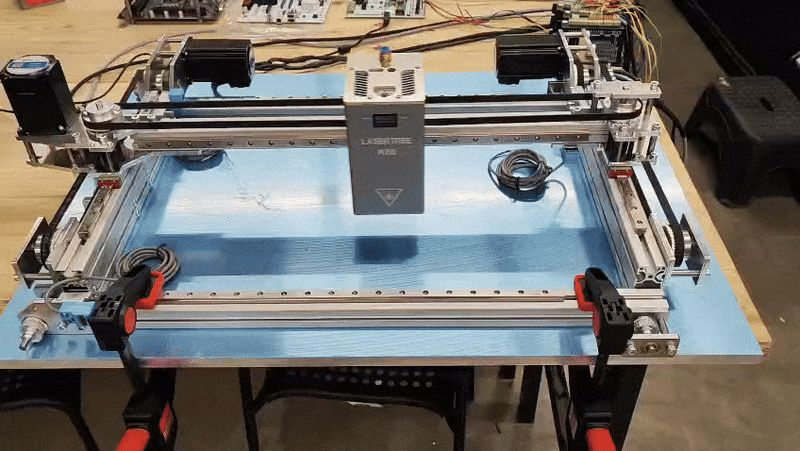
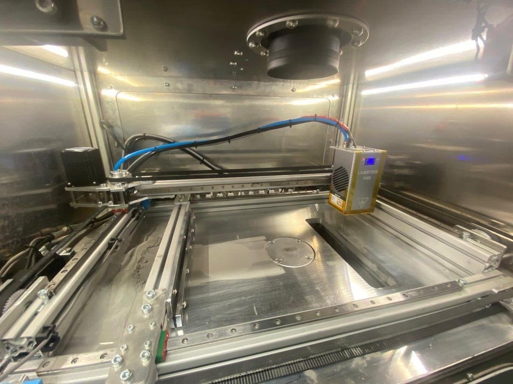
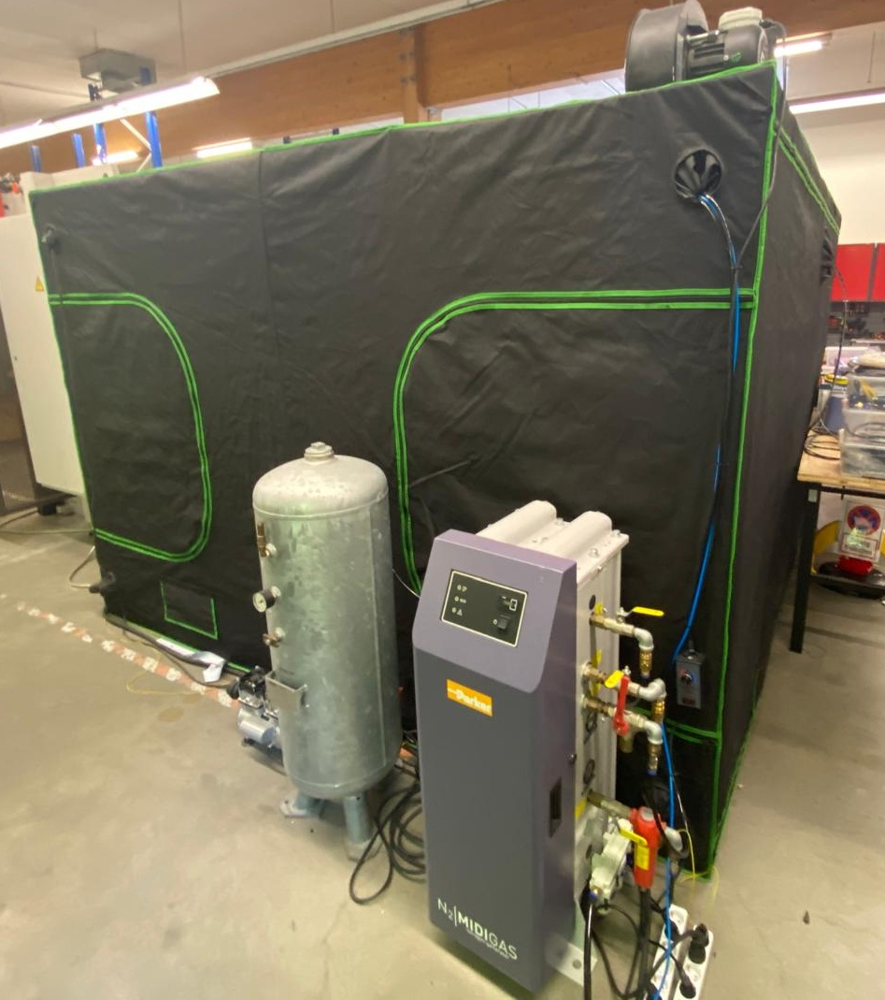
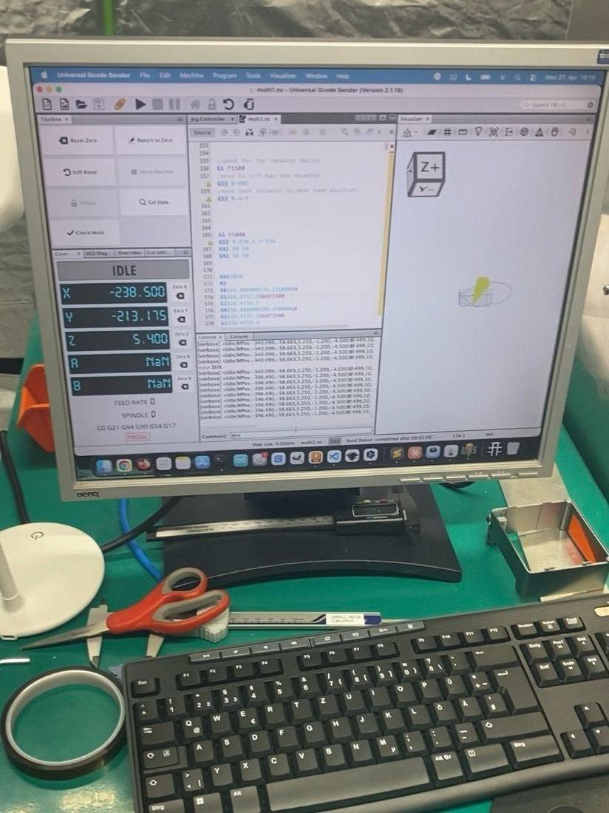
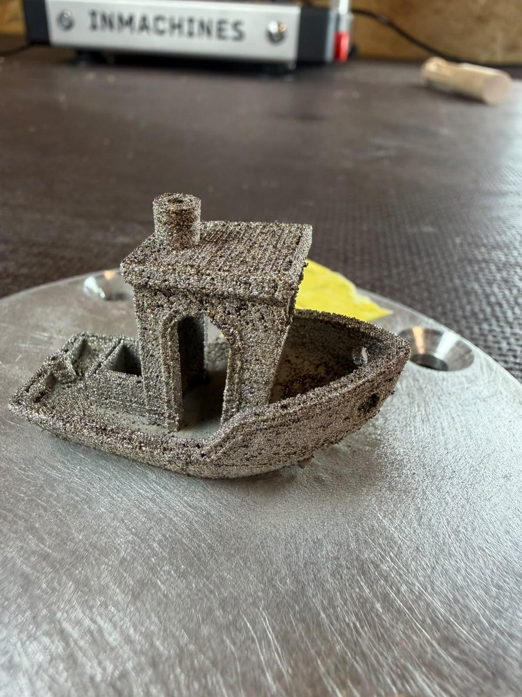
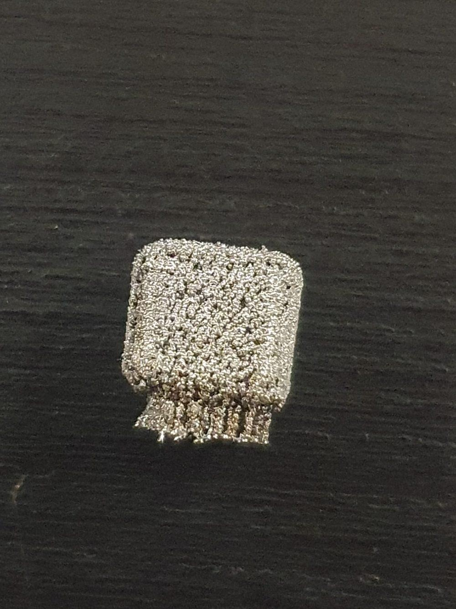

<h1 style=align="center">OISK Metal 3D Printer</h1>

<i>Open source metal 3D printer (LPBF) - Open Industrial Starter Kit</i>

 

Introduction
--

The OISK Metal 3D Printer is an open source metal additive manufacturing machine based on **Laser Powder Bed Fusion (LPBF)**. It is designed as a *dual-configuration* platform: the same machine architecture can be operated with a low-cost multi-diode laser source or with a fiber laser source, so that the cost and the capability of the machine can be scaled to the application.

The machine is built around a Cartesian gantry carrying the optics over a circular build area, with a reserve cylinder and a printing cylinder driven by stepper-actuated pistons, a blade recoater for powder deposition, and a fully enclosed stainless steel cabinet running a nitrogen atmosphere. The current prototype runs a **60 W, 450 nm blue diode** source and has been validated with **316L stainless steel**.

The aim of the project is to make metal additive manufacturing accessible outside of the proprietary, closed and expensive machine market, by releasing a replicable machine with open CAD, open electronics, open documentation and open software.

<i>Machine architecture: enclosure, gantry with galvo scanner and laser diode, reserve and printing cylinders</i>

Specifications
--

- process: Laser Powder Bed Fusion (LPBF)
- configuration: dual-configuration laser source (multi-diode / fiber)
- laser: 60 W, 450 nm blue diode module
- build area: circular build platform
- motion: Cartesian XY gantry, five axes - X and Y carry the laser head, Z drives the build piston, A the powder reservoir, B the blade recoater
- axis travel: X 400 mm, Y 200 mm, Z 92 mm, A 102 mm, B 425 mm
- powder handling: SFU1204 ball screws on Z and A, aluminium cylinders and pistons with PTFE inserts, blade recoater
- validated layer height: 0.075 mm
- build chamber: fully enclosed, nitrogen atmosphere, chamber O₂ typically below 0.5% after purge
- thermal architecture: passive - no build-plate heater, no chamber pre-heat, no active cooling
- housing: stainless steel cabinet with viewing window, aluminium profile frame
- controller: in-house, Teensy 4.1 and RP2040, grblHAL
- validated material: 316L (1.4404) stainless steel, gas atomised, 10-45 µm
- software: OLOS - Open Lab Operating System

### Laser source specifications

| Property | Value |
| --- | --- |
| Module | LASER TREE K60, 6-diode |
| Wavelength | 450 nm ± 10 nm (blue diode) |
| Rated optical power | 60 W+ (switchable 20 / 40 / 60 W; operated in 60 W mode) |
| Measured optical power | 69-71 W (5-unit sample, mean 70.4 W) |
| Output stability | 1.8-3.4% attenuation over 30 min continuous operation |
| Focal length / focus | 40 mm, fixed focus with adjustment lever |
| Spot size at 60 W | 0.15 × 0.25 mm (rectangular) |

 

<i>Gantry with galvo scanner (left) and the reserve / printing cylinder assembly (right)</i>

 

 

<i>Gantry prototype (left) and build platforms (right)</i>

 

<i>Assembly of the printing cylinder with the piston and the lead screw</i>

The Machine in Operation
--

<i>The process chamber: gantry, laser head, build bed, powder reservoir and recoater</i>

 

The machine is installed inside a dedicated containment tent that confines the fine 316L powder. The gas and air plant stands immediately outside it: a compressed-air supply feeding a membrane nitrogen generator, a nitrogen buffer tank and a vacuum pump. A free-standing air filter unit filters and recirculates the tent atmosphere.

  

<i>Containment tent with nitrogen generator and buffer tank (left), air filter unit (centre), operator station inside the tent (right)</i>

Process Settings
--

A systematic process-parameter campaign of twenty-two builds was carried out on this machine to develop a working 316L process. The complete record - laser, feedstock, hardware, controller configuration, the validated slicer recipe and the process window - is published as a workbook:

- **[Machine and Process Settings](settings/OISK_Metal_3D_Printer_Settings.xlsx)**

### Validated recipe

The table below is the zone-by-zone configuration of the first geometrically complete 316L part produced on the machine - a closed hull, deck and cabin over 463 layers at 0.075 mm, built in approximately 6 hours. Power is commanded as the percentage **S** of the 60 W mode and feed **F** in mm/min; VED is the volumetric energy density P / (v · t · h).

| Zone | Layers | Power / feed | Emitted pitch | VED |
| --- | --- | --- | --- | --- |
| First (engraved) | 4 | S55 / F3000 | 0.200 mm | 44.0 J/mm³ |
| Intermediate (engraved) | 5 | S45 / F4000 | 0.200 mm | 27.0 J/mm³ |
| Bulk infill (vector) | 454 | S33 / F6000 | 0.200 mm | 13.2 J/mm³ |
| Bulk contour, 3 lines | — | S40 / F6000 | 0.200 mm | 16.0 J/mm³ |
| Flat surface skin | 14 | S30 / F3000 | 0.266 mm | 18.0 J/mm³ |
| Slanted surface skin | 12 | S30 / F3500 | 0.200 mm | 20.6 J/mm³ |

The full OLOS slicer settings record for this build is in the workbook, so the part can be reproduced on an OISK machine without reference to the thesis.

### Process window

| Regime | Energy density | Power / feed |
| --- | --- | --- |
| Validated lattice regime | 12-16 J/mm³ | S33-S35 / F6000 |
| Solid-section bulk | 18-24 J/mm³ | see workbook |
| Sacrificial anchor pad | 30-36 J/mm³ | S50-S55 / F3000 |
| Anchoring layers | 27-44 J/mm³ | S45-S55 / F3000-F4000 |

The central result of the campaign is that the achievable process window on this platform is bounded by **thermal boundary conditions** rather than by the laser or by parameter choice: static in-band energy densities fail as build height grows, while a height-staged power and feed profile sustains builds at a nominally sub-threshold 12-16 J/mm³ by exploiting accumulated substrate heat. The measured platform signature is a constant additive dimensional deviation of **+0.23 mm** and a melt track width of **0.38 mm**.

> These are prototype research settings developed on one machine, not a qualified production process. They are published so the builds can be reproduced and improved on.

### Results

 

<i>The validated full part: a geometrically complete 316L benchmark with closed hull, deck and cabin</i>

 

 

<i>Solid-section 8 mm specimens built on a sacrificial anchor pad</i>

Files
--

- **[CAD](cad)** - Fusion 360 and STEP models of the machine (see [cad/README.md](cad/README.md) for how to reassemble the split archives)
- **[Settings](settings/OISK_Metal_3D_Printer_Settings.xlsx)** - machine, controller and process settings
- **[BOM](OISK_Metal_3D_Printer_BOM_Preliminary.xlsx)** - *preliminary*
- **[Firmware](firmware)** - *in preparation*
- **Wiring Schematic** - *in preparation*

Roadmap
--

Next steps planned until December 2026:

- testing of the fiber laser source (dual-configuration LPBF)
- integration of the new controller PCB
- machine refinement based on the prototype results
- full open documentation release - BOM, CAD, assembly manual
- further publication in preparation

Publication
--

- T. Redlich, D. Ingrassia, M. Moritz, M. Omer, *Towards an Open Source Metal 3D Printer: A Dual-Configuration LPBF Concept Based on Benchmarking and Design Analysis*, Procedia CIRP, Vol. 142 (2026) - open access

- D. Tiwari, *Process Parameter Development for Laser Powder Bed Fusion of 316L Stainless Steel on the OISK Open-Source Platform*, Bachelor Thesis, Rhine-Waal University of Applied Sciences, Faculty of Technology and Bionics, 21.10.2026

Author
--

The OISK Metal 3D Printer has been designed and built by **[InMachines Ingrassia GmbH](https://www.inmachines.net/)**.

 

Machine design:
- **[Daniele Ingrassia](https://www.linkedin.com/in/danieleingrassia/)**

316L process development and the OLOS metal slicing workflow:
- **Dharunjay Tiwari**

The machine is part of the **Open Industrial Starter Kit (OISK)** group of open source industrial digital fabrication machines.

OISK is developed by **[InMachines Ingrassia GmbH](https://www.inmachines.net/)** for the **[Dtec project](https://dtecbw.de/home/forschung/hsu/projekt-fabcity)** at **[Fab City Hamburg](https://www.fabcity.hamburg/en/)**.

Contact
--

- daniele@inmachines.net
- [https://www.inmachines.net/](https://www.inmachines.net/)

License
--

Hardware design, CAD and PCB files, BOM, settings and other technical or design files are released under the following license:

- CERN Open Hardware Licence Version 2 Strongly Reciprocal - **[CERN-OHL-S](LICENSE_CERN_OHL_S_V2.txt)**

Assembly manual, pictures, videos, presentations, description text and other type of media are released under the following license:

- Creative-Commons-Attribution-ShareAlike 4.0 International - **[CC BY-SA 4.0](LICENSE_CC_BY_SA_4.0.txt)**

Copyright
--

- Daniele Ingrassia, InMachines Ingrassia GmbH

- Tobias Redlich, Helmut-Schmidt-Universität/Universität der Bundeswehr Hamburg
