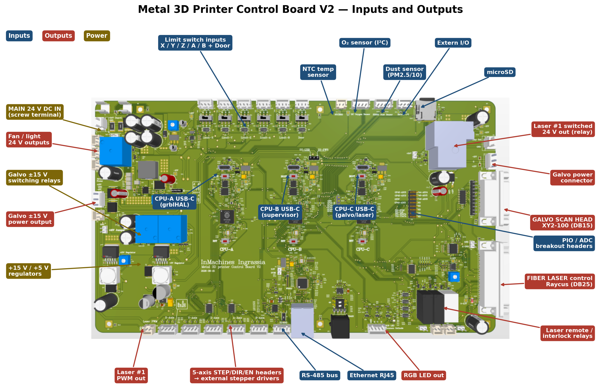

# Control Board V2 - OISK Metal 3D Printer

The **Metal 3D Printer Control Board V2** (InMachines Ingrassia, board revision 2026-06-15) is the
single-board controller for the machine. It combines three subsystems that are usually separate
industrial boxes: a grblHAL motion controller, a fiber-laser interface and a galvo scanner interface.

<div align="center"></div>

## Files

| File | Contents |
| --- | --- |
| **[MetalPrinter_V2_Schematic.pdf](MetalPrinter_V2_Schematic.pdf)** | Full schematic set, 9 sheets, Altium Designer |
| **[MetalPrinter_V2_User_Manual.pdf](MetalPrinter_V2_User_Manual.pdf)** | Board architecture guide for new users |
| **[MetalPrinter_V2_Documentation.md](MetalPrinter_V2_Documentation.md)** | Hardware documentation: power, control, motion, laser and galvo interfaces |
| **[MetalPrinter_V2_IO_Annotated.png](MetalPrinter_V2_IO_Annotated.png)** | Annotated map of every input, output and power connector |
| **[BOM](BOM)** | Bill of materials, 142 line items, as exported 2026-06-15 |
| **[Altium](Altium)** | Altium project source - schematic sheets, PCB layout, draftsman document, project and output job files |
| **[Manufacturing](Manufacturing)** | Gerbers, drill files and pick-and-place data |
| **[Step](Step)** | 3D STEP model of the assembled board |

## Architecture

The work is split across **three RP2350B microcontrollers**, each with its own USB-C port:

| CPU | Role | Responsibilities |
| --- | --- | --- |
| **CPU-A** | Motion | grblHAL, 5 axes of buffered STEP/DIR/EN for external stepper drivers, six isolated end-stop inputs, Laser #1 PWM and relay |
| **CPU-B** | Supervisor | Ethernet, USB, RS-422, RS-485, environment sensors, microSD, RGB status LED, UART bridges to A and C |
| **CPU-C** | Galvo and fiber laser | XY2-100 generation in PIO, Raycus fiber-laser control set, 8 MB PSRAM for scan-path buffering |

## Key specifications

| Item | Value |
| --- | --- |
| Main supply | 24 V DC, 10 A, dual fused, 0.02 Ω low-side shunt for current monitoring |
| Derived rails | 24 V→5 V buck, 5 V→3.3 V LDO per CPU, ±15 V for the galvo, ~18 V for end-stop sensors |
| Controllers | 3 × RP2350B, 4 MB QSPI flash each, USB-C each; CPU-C adds 8 MB PSRAM |
| Motion | 5 axes (X, Y, Z, A, B), buffered 5 V STEP/DIR/EN for external stepper drivers, per-signal indicator LEDs |
| End stops | 6 isolated channels (X, Y, Z, A, B, Door), 18 V sensor supply, NC/NO DIP select, optocoupled |
| Laser #1 | 24 V diode channel: power relay plus 5 V logic PWM - Laser Tree K60 class |
| Laser #2 | Raycus RFL-C200A fiber laser over DB25: 0-10 V analog power, modulation, enables, interlock relays, four opto-isolated status inputs, power feedback ADC, RS-232 |
| Galvo | XY2-100 over quad differential line driver to DB15, ±15 V switched by relay so the head is unpowered until firmware closes them |
| Networking | Ethernet (W5500 + MagJack), RS-422, RS-485, RS-232, I²C, 3 UART links |
| Sensors | NTC3950 thermistor, I²C oxygen sensor, SDS011 PM2.5/PM10 dust sensor, INA22x current monitor |
| Storage and UI | microSD with card detect, on-board and external RGB status LED, GPIO/ADC breakout headers |

The oxygen and dust sensor inputs are specific to metal printing: the chamber has to be kept inert and
low in oxygen, and fine metal powder has to be monitored in and around the machine.

Full detail, including the power-on sequence for the fiber laser and the end-stop wiring conventions,
is in **[MetalPrinter_V2_Documentation.md](MetalPrinter_V2_Documentation.md)**.

## Reassembling the Altium project

The Altium source is compressed and split into parts of max. 24.9 MB to stay inside the GitHub file
size limits. Download all the parts into the same folder, join them and extract:

```bash
cat "MetalPrinterV2_Altium_Project.zip."* > "MetalPrinterV2_Altium_Project.zip"
unzip "MetalPrinterV2_Altium_Project.zip"
```

On Windows, in `cmd`:

```bat
copy /b "MetalPrinterV2_Altium_Project.zip.001" + "MetalPrinterV2_Altium_Project.zip.002" + "MetalPrinterV2_Altium_Project.zip.003" + "MetalPrinterV2_Altium_Project.zip.004" "MetalPrinterV2_Altium_Project.zip"
```

or right click the `.001` part and choose *7-Zip > Extract Here*, which joins the parts automatically.

## Status

The board is designed, fabricated and populated. Its integration into the machine is on the
[roadmap](../README.md#roadmap) - the process campaign documented in [settings](../settings) was run
on the previous controller generation (Teensy 4.1 and RP2040).

Third-party vendor manuals that were part of the design folder - the laser module and fiber laser user
guides - are not redistributed here. Obtain them from the respective manufacturers.

## License

The PCB design files, schematic, BOM and manufacturing data are released under the CERN Open Hardware
Licence Version 2 - Strongly Reciprocal (**CERN-OHL-S**), see
[LICENSE_CERN_OHL_S_V2.txt](../LICENSE_CERN_OHL_S_V2.txt).
